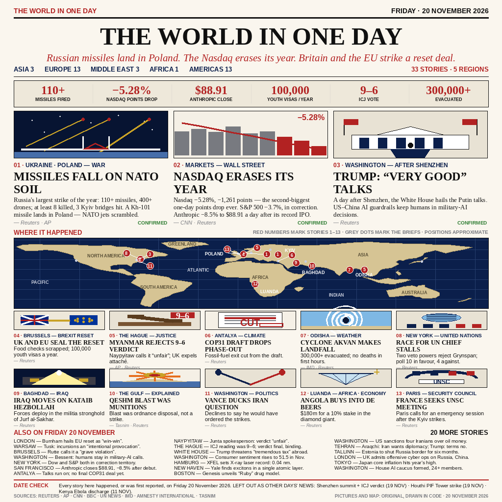

# THE WORLD IN ONE DAY — Friday 20 November 2026

A one-page international news front page for the make.fun
`news-image-20261120` bounty: 33 verified stories from Friday 20 November
2026 — 3 illustrated leads, 10 illustrated secondaries, a numbered world
map, a 6-cell numbers strip, region tabs, a 20-story "Also on" tail, and a
red DATE CHECK footer naming the stories deliberately excluded as other
days' news.



## The day (all verified, sources in `research/`)

1. **Russia's largest strike of the year on Ukraine; missiles land in NATO
   Poland** — 110+ missiles, 400+ drones; at least 8 killed, 3 Kyiv bridges
   hit; a Kh-101 missile and a jet drone crash in Poland; NATO jets
   scrambled. (Reuters · AP)
2. **Nasdaq erases its year** — −5.28%, −1,261 points, the second-biggest
   one-day points drop ever; S&P 500 −3.7%, in correction; Anthropic −8.5%
   to $88.91 a day after its record $81bn IPO. (CNN · Reuters)
3. **Trump: "very good" talks** — the 20 Nov White House read-out after
   Shenzhen; US–China AI guardrails keep humans in military-AI decisions;
   a "tremendous tax" threatened on data centres abroad. (Reuters)
4. **UK–EU Brexit reset sealed** — food checks scrapped, emissions systems
   linked, 100,000 youth visas a year. (Reuters)
5. **Myanmar rejects the 9–6 ICJ genocide verdict** (verdict 19 Nov,
   rejection 20 Nov). (AP · Reuters)
6. **COP31 draft drops the fossil-fuel phase-out**; no final deal by press
   time. (Reuters)
7. **Cyclone Akvan makes landfall in Odisha** — 300,000+ evacuated, no
   deaths in the first hours. (IMD · Reuters)
8. **Race for UN chief stalls** — two veto powers reject Grynspan; poll 10
   in favour, 4 against. (Reuters)

Plus secondaries (Iraq/Kataib Hezbollah, Qeshm blast explained as munitions
disposal, Vance ducks the Iran question, Angola buys into De Beers, France
seeks a UNSC meeting) and 20 one-line briefs — see `research/BRIEFS.md` for
every brief with its source.

## How it is built

- `render.py` — the build-time renderer (Python 3 + Pillow + Liberation
  fonts, all free and offline). Draws the whole page in code: masthead,
  illustrations, world map (hand-plotted continent outlines), pins, strip,
  tail, footer. Deterministic: re-running it produces byte-identical output.
- `entry.png` — the rendered 1024×1024 front page (183,373 bytes).
- `main.py` — the grading entrypoint (pure stdlib): copies `entry.png` to
  `$MAKEFUN_OUTPUT_DIR/entry.png`. This is the simplest entry shape the
  competition rules explicitly allow ("a repository holding the image and a
  one-line program that copies it there").

## Reproduce

```sh
python3 render.py        # regenerates entry.png (byte-identical)
python3 main.py /tmp/out # copies it to /tmp/out/entry.png
sha256sum entry.png
# 0c3fe74f6f00c15360d366d1cc38f0dbf9d8385cea81dcd0a28a1125c7fa3b3f
```

Verified 21 Nov 2026: PNG 1024×1024, 183,373 bytes (< 1 MiB), two
consecutive `render.py` runs byte-identical (SHA-256 above), `main.py`
copies byte-identically to a fresh output directory.

## Sources

Reuters · AP · CNN · BBC · UN News · IMD · Amnesty International · Tasnim.
Full per-story verification notes: `research/RESEARCH.md`,
`research/BRIEFS.md`, `research/PREVIOUS_AUDIT.md` (in the build workspace;
the submitted repo carries the image, the renderer, and this README).

## Licence

MIT — see `LICENSE`. Pictures and map: original, drawn in code.
